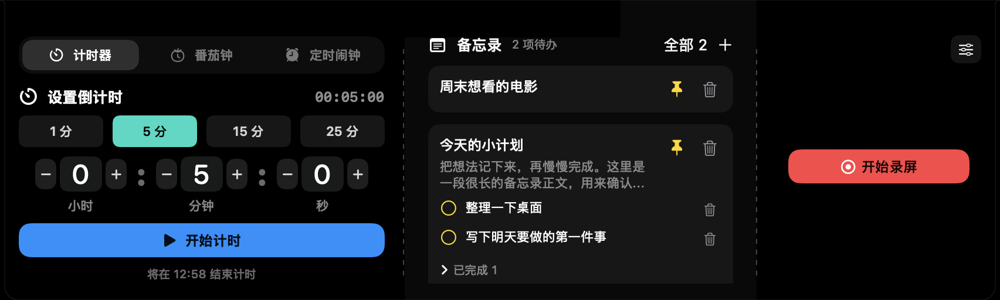
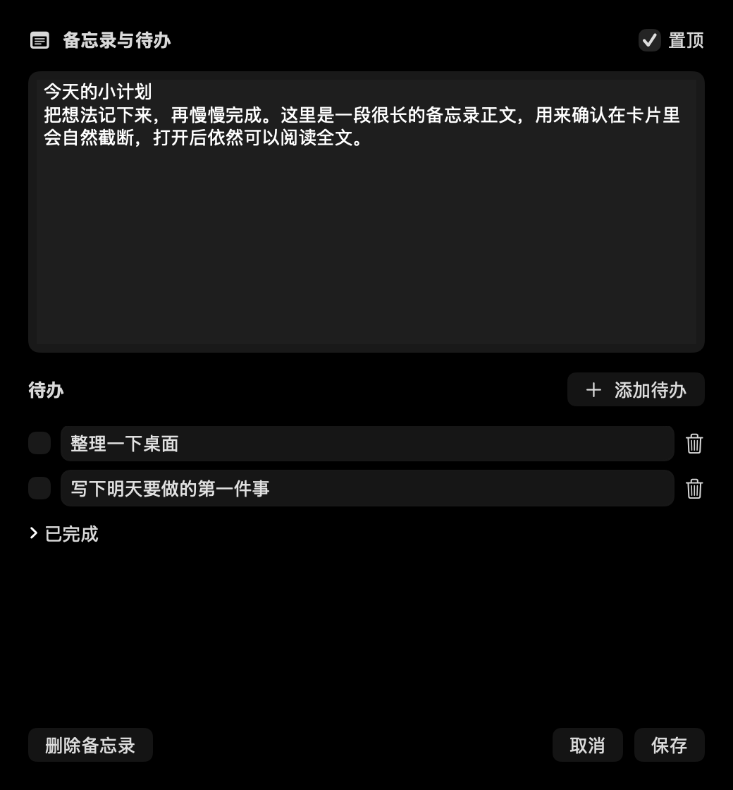

# DynamicIsland

macOS 菜单栏灵动岛：把 AI 任务、音乐、计时、电源与设备状态放到屏幕顶部，并提供本地备忘录和录屏工具。使用 Swift / SwiftUI / AppKit 编写，当前面向从源码构建的用户。

> 源码和项目自定义图标采用 MIT License，见[素材清单](docs/assets.md)。当前提供从源码构建的方式，尚未提供正式分发安装包。

## 功能

- 紧凑状态与展开面板；根据刘海区域和屏幕宽度调整布局，模块过多时分页。
- 显示 Codex、Claude Code、DeepSeek Harness 的本地任务状态、耗时与未读完成提示；集成依赖上游本地数据格式。
- 显示音频播放来源；Apple Music 曲目信息、封面和歌词尽力读取，受权限、语言和私有接口影响。
- 倒计时、番茄钟与定时闹钟；本地备忘录、置顶和待办。
- Mac 电源与设备信息、USB 连接及部分 iPhone 信息。
- 全屏、窗口或区域录屏，支持倒数、暂停／继续、系统声音与可选麦克风，导出 MP4。
- 模块显示、长度与时间工具设置；会话锁定时覆盖内容并隐藏备忘录编辑窗口。

下图由项目自己的 SwiftUI 视图离屏渲染，文字来自 `Tests/NotesUIRender.swift` 的内存样例。没有捕获用户屏幕，也没有使用真实任务、歌曲封面或第三方品牌图形；展示录屏按钮不表示进行了真实录屏。





## 系统与开发环境

| 项目 | 当前情况 |
| --- | --- |
| 最低部署版本 | 工程与本次构建产物均为 **macOS 26.5**；未在该最低版本实机验收 |
| 已验证环境 | macOS 27.0.1、Xcode 27.0（27A266a）、Apple Swift 6.4 |
| Xcode 要求 | 使用完整 Xcode；当前可复现基线为 27.0，更早版本的最低要求尚未验证；仅 Command Line Tools 不足以完成工程构建 |
| Apple silicon | 本次 Release 构建、自动检查与离屏 UI 渲染已通过；产物为 `arm64` |
| Intel / Universal | 未构建、未运行验证；不承诺 `x86_64` 或 Universal 支持 |
| 构建依赖 | 系统框架，无 Swift Package、CocoaPods 或外部二进制包；部分可选集成另有运行时依赖 |

以上验证不等同于全部功能的实机端到端验收，尤其是真实录屏、设备、锁屏通知与多显示器行为。

## 从源码构建与运行

下载或克隆本仓库，在包含 `DynamicIsland.xcodeproj` 的仓库根目录打开 Terminal：

```sh
git clone https://github.com/OAKunO/DynamicIsland.git
cd DynamicIsland
```

确认正在使用完整 Xcode：

```sh
xcode-select -p
xcodebuild -version
```

若选择了 Command Line Tools 或其他 Xcode，请先将系统开发者目录切换到需要使用的完整 Xcode，并完成 Xcode 首次启动设置。

首次在自己的 Mac 开发且尚无本地签名身份时：

```sh
zsh scripts/setup-local-signing.sh
```

脚本在登录钥匙串中建立名为 `DynamicIsland Local Development` 的自签代码签名身份，并设置代码签名信任；已有可用身份会直接复用。同名证书存在但不可用时应修复现有身份。不要删除或重新生成身份来绕过构建问题，也不要将证书私钥提交到仓库。

然后构建：

```sh
zsh scripts/build-and-install.sh
```

此命令只构建 Release 并验证签名，不安装、不启动应用。产物与日志：

- `.derivedData/LocalSignedBuild/Build/Products/Release/DynamicIsland.app`
- `.derivedData/LocalSignedBuild/build.log`

需要安装到本机时，先通过菜单栏的「退出灵动岛」正常退出正在运行的版本，再执行：

```sh
zsh scripts/build-and-install.sh --install
zsh scripts/verify-app-signature.sh /Applications/DynamicIsland.app
```

仅当安装和签名验证均成功后，才手动打开 `/Applications/DynamicIsland.app`，或执行：

```sh
open /Applications/DynamicIsland.app
```

安装流程会将旧版本备份到 `.derivedData/AppBackups/`。应用通过菜单栏「设置…」配置模块，通过「显示 / 隐藏灵动岛」控制悬浮窗口。系统权限按功能需要单独授权，见[隐私与权限](PRIVACY.md)。

### 本地签名与对外分发

Bundle ID 固定为 `OAKunO.DynamicIsland`；每位开发者在自己的钥匙串中使用上述同名本地身份，**不共享维护者的私钥**。固定证书用于保持本机迭代构建的代码身份一致，签名验证本身不会授予录屏等系统权限。

本地自签身份不等同于 Apple 签发的 Developer ID，也不包含 Apple 公证（notarization）。它不能作为面向其他用户下载时的 Gatekeeper 信任保证。Developer ID 与公证属于未来正式分发的另一个流程，见 [Apple 说明](https://developer.apple.com/help/account/certificates/create-developer-id-certificates)。从源码进行本地构建不需要本项目维护者购买 Apple Developer Program。本次未涉及 Mac App Store、Developer ID 申请或正式分发包。

完整本机构建与安装约束见 [AGENTS.md](AGENTS.md)。不要用未签名或 ad-hoc 签名的产物安装覆盖本机应用。

## 权限、数据与网络

- 屏幕与系统音频权限用于录屏；音频播放检测也会使用 Core Audio process tap。麦克风仅在录屏选项开启时使用。
- Music 自动化（Apple Events）用于读取曲目、封面与本地歌词；辅助功能用于查找 Music 界面的歌词文字并操作歌词面板。拒绝权限会影响相应功能。
- 备忘录保存在 `~/Library/Application Support/DynamicIsland/memos-v1.json`；设置、目录书签和未读完成任务等保存在本机 UserDefaults。未读任务可能包含标题和工作目录。
- AI 集成读取本机任务数据库、日志或会话文件，不需要在 DynamicIsland 中填写 AI API key。当前代码未发现 analytics、账号登录或内容上传服务。
- **歌词 fallback 会自动联网**：本地歌词不足时，向 `lrclib.net` 发送歌名、歌手、专辑和时长；未单独提供联网开关，隐藏音乐模块也不保证停止后台监测或请求。服务方还可见请求 IP 等常规连接信息。

详细数据来源、保存位置和限制见 [PRIVACY.md](PRIVACY.md)。应用未启用 App Sandbox；权限说明不代表进程被沙盒限制为仅能访问所列数据。

## 可选集成与兼容性限制

| 集成 | 运行时依赖与限制 |
| --- | --- |
| Codex | 读取 `~/.codex/` 下的 SQLite、rollout、IPC socket 及 `~/Library/Logs/com.openai.codex/`；数据库版本名与非公开订阅协议会随上游变化 |
| Claude Code | 读取 `~/.claude/sessions/`、`~/.claude/projects/` 的会话与 transcript，并结合进程／socket 信息判断状态；上游格式变化可能导致缺失或误判 |
| DeepSeek Harness | 实验性集成；发现 `~/.dsh/` 和 `~/Deepseek-Harness/` 的会话数据，并依赖后者 checkout 中的 tsx / zstd 读取代码以及 `~/.nvm/versions/node/*/bin/node`；不会自动安装这些依赖，常规安装布局未验证 |
| 音乐 | 运行时加载 Apple **私有框架 MediaRemote**，结合 Core Audio、AppleScript 和辅助功能；其他播放器只尽力检测来源，不能保证获得歌曲／歌词 |
| iPhone | 运行时加载 Apple **私有框架 MobileDevice**，读取可访问且已配对设备的信息；锁定、信任／配对状态和系统版本均会影响结果 |

私有框架、符号与上游数据格式不是稳定公开 API。当前存在空数据／缺失接口的降级路径，仍不能保证未来 macOS 或第三方应用版本兼容。Music 辅助功能查找含中文界面名称，其他系统语言未验证。刘海与窗口布局有自动检查；多屏、缩放、触控板、真实锁屏／解锁时序仍需实机验收。

应用退出期间不会提供计时提醒。`docs/automatic-reminders-design.md` 是**尚未实现的设计提案**，不代表已经提供自动执行命令或登录时启动功能。

## 检查与贡献

```sh
zsh scripts/run-tests.sh
zsh scripts/render-notes-ui.sh
```

默认测试使用 fixture、随机 UserDefaults suite、临时文件、本地模拟 socket 和合成音视频；不安装应用、不进行真实屏幕录制。签名测试仅操作临时 app fixture。Codex 与手机测试的 `--live` 参数属于另行选择的本机诊断，会读取实际任务或设备信息。

其他 UI 检查入口为 `zsh scripts/render-notch-ui.sh` 与 `zsh scripts/render-paging-ui.sh`，只渲染项目视图，不截取用户屏幕。渲染产物在 `.derivedData/`。AppKit、SwiftUI 编译插件、测试 socket、ScopedBookmarksAgent 和钥匙串需要可用的本机环境；受限沙盒中的失败不应通过禁用签名或跳过断言绕过。

阅读 [CONTRIBUTING.md](CONTRIBUTING.md) 了解结构和检查方法；功能细节见[备忘录与待办](docs/notes-and-todos.md)、[展开面板分页](docs/expanded-dashboard.md)。

## License 与素材

源码、本项目文档、AppIcon 和维护者选定的 AI 生成状态图标采用 [MIT License](LICENSE)，版权署名为 **Copyright (c) 2026 OAKunO**。保留版权与许可声明后，允许使用、修改、再分发及销售代码，也允许闭源衍生产品。详情见 [License 说明](docs/licensing-options.md)。

Codex 使用自定义「代码火花」，DeepSeek Harness 使用自定义「蓝色放大镜」；两者由 AI 生成并经维护者选定，应用资源与公开候选不再包含此前的 OpenAI 结形图标或 DeepSeek 鲸鱼 SVG。这些状态标识不表示官方关系或背书。README 只使用本项目离屏渲染的样例。素材及生成记录见 [docs/assets.md](docs/assets.md) 和 [生成 prompts](docs/generated-status-icons.json)，替换前的官方条款核验留存于[品牌图形说明](docs/brand-usage-review.md)。

`output/`、`generated_images/`、`.derivedData/` 是本地预览、宣传源文件和构建结果，应用不读取它们，已从新增文件候选中排除。`.gitignore` 不会清理已跟踪文件或历史；首次发布的审核步骤见 [docs/publishing.md](docs/publishing.md)。
